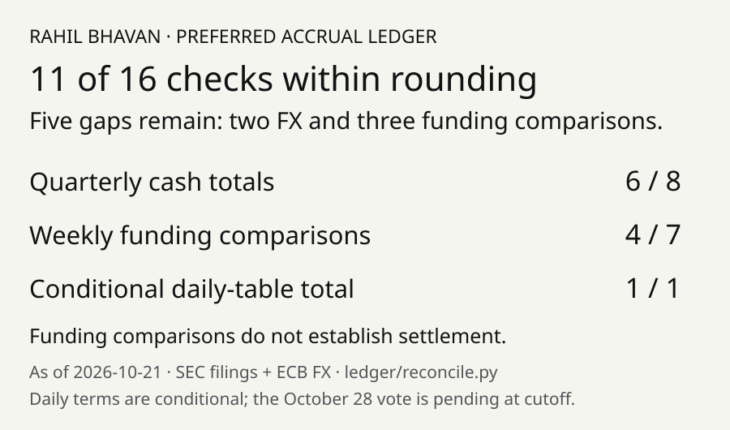

# Preferred accrual ledger: replay five sourced preferred dividend schedules



An offline event-replay tool for Strategy's STRF, STRC, STRE, STRK and STRD dividend schedules, entitlements and unpaid scenarios. It preserves USD/EUR currencies and sources, fixes entitlement at record dates, and separates cumulative arrears from noncumulative STRD. Financial cutoff: **October 21, 2026**. The [review](docs/audit.md) explains five unresolved aggregate differences without fitting source values.

## What it does

- Replays 37 sourced events from a June 30 opening balance under existing terms and emits dated schedules through March 2027 (`results/current/`). Future payments and settlement of declarations are assumptions.
- Tests all 30 rows of the conditional November STRC daily table. Daily terms are available only with `--scenario approved`; the October 28 vote remains pending at the cutoff.
- Reports 11 of 16 aggregate reconciliation checks within source rounding tolerance. Five mismatches remain visible; FX, record-date share assumptions and funding-versus-settlement differences limit agreement (`reconciliation.json`).
- Rejects duplicate/conflicting IDs, supports idempotent JSONL append/reload, and tests record-date entitlement, compounding, step-up caps and undeclared STRD forfeiture.

## How it works

`ledger/filings.py` parses cached filings; `seed.py` creates attributed events; `schedule.py` computes per-share schedules; `engine.py` replays shares, declarations and payment assumptions; `reconcile.py` compares model amounts with filed totals. No bank settlement feed is connected.

## Run it

Python 3.12+; local validation uses Python 3.14.7 and CI pins Python 3.14.0. Standard library only. From a fresh clone:

```bash
git clone https://github.com/RahilBhavan/preferred-accrual-ledger.git
cd preferred-accrual-ledger
python3 scripts/snapshot.py
python3 scripts/verify_sources.py
python3 -m unittest discover -s tests -v
python3 -m ledger
python3 -m ledger --scenario approved --out results/approved
python3 scripts/validate.py
python3 scripts/figure.py
```

Observed: **36 tests passed**. Current terms produce 37 events and 30 schedule rows; the approved scenario produces 72 events and 438 rows through March 2027. Both produce `schedule.csv`, `events.jsonl`, `summary.json` and `reconciliation.json`. No credentials or dependency install are needed. `validate.py` verifies source hashes, runs tests and repeats both demos, comparing eight output hashes. `figure.py` rebuilds the figure and a responsive local result table; it does not host a website.

## Repository layout

- `ledger/`: terms, calendars, events, replay, reconciliation and CLI.
- `scripts/`: offline source restoration and hash verification.
- `snapshot/`: compressed frozen source cache.
- `provenance/`: source URL/date/hash inventories.
- `tests/`: real-source checks and replay invariants.
- `docs/`: scope, terms, reconciliation and validation.

## Documentation

- [Scope and acceptance](docs/spec.md): local v1 contract.
- [Terms and limitations](docs/terms.md): schedules, scenarios and arrears boundary.
- [Reconciliation](docs/reconciliation.md): unresolved mismatches and provenance.
- [Validation](docs/validation.md): tests and reproducibility checks.
- [Correctness review](docs/audit.md): proven fixes and all five aggregate gaps.
- [Consumer contract](docs/contracts.md): portable source and output formats for other tools.
- [Publication receipt](docs/publication.md): commit, clean-clone and CI evidence.

## Sources

The snapshot preserves 44 attributed source bodies: primary SEC filings/declarations and ECB currency observations. Financial inputs include the June 2026 10-Q and weekly 8-Ks through October 19. See `provenance/` and the [source discussion](docs/reconciliation.md). The archive and individual bodies have SHA-256 checks; original URL/fetch metadata is restored with the cache. Third-party filings/data are attributed research inputs; no ownership of them is claimed.

## Scope and limits

- Independent research, not affiliated with Strategy. This is not an operational paying-agent ledger.
- Existing quarterly/semi-monthly terms are the default. Daily approval is a hypothetical branch; STRE remains quarterly.
- Zero opening arrears; weekly share changes use assumed dating. Declared amounts are assumed settled; absent evidence is not proof of an actual missed dividend.
- Current-term arrears use approximate open-period/stub treatment. Daily-scenario arrears, late declarations and early/late payment events are rejected. Cross-series legal payment blockers are not modeled.
- STRK stock payments are monetary values, not delivered share counts. Holidays use encoded rules without ad hoc closures. See terms before extending to other years.
- USD and EUR are not summed implicitly. Aggregate reconciliation is incomplete.
- Replay uses the supplied frozen event set; `as_of` controls payment projections, not point-in-time availability of every filing. JSONL retry/restart supports a serial writer; it has no concurrent-writer or crash-durability guarantee.

## License

No license file yet. Third-party filings/data retain their owners' rights.

Part of [Rahil Bhavan's projects](https://github.com/RahilBhavan).
